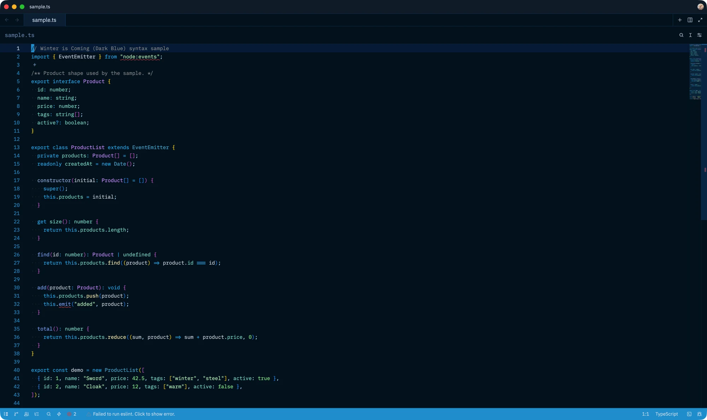

# Winter is Coming for Zed

Community port of [John Papa's Winter is Coming](https://github.com/johnpapa/vscode-winteriscoming)
theme to [Zed](https://zed.dev), using the original Dark Blue palette.



## Install

1. Open Zed.
2. Open the command palette with `Cmd+Shift+P`.
3. Run **zed: extensions** and search for **Winter is Coming**.
4. Run **theme selector: toggle** and choose **Winter is Coming (Dark Blue)**.

VS Code leaves `editorBracketHighlight.foreground*` unset in this theme, so it
uses VS Code's native bracket-pair colorization defaults. Zed maps the same
gold, orchid, and blue accents for bracket colorization.

Zed does not expose VS Code's `statusBarItem.activeBackground` theme key, so
selected status-bar icons use the theme's highlight color instead of a
background block.

If the extension is not in the marketplace yet, clone this repository and use
**zed: install dev extension** from the command palette.

Zed highlights code with Tree-sitter captures rather than VS Code semantic
tokens, so a few context-specific token differences remain unavoidable.

## Development

The theme is generated from the palette and Zed style mappings in `src/`.
Do not edit `themes/winter-is-coming-dark-blue.json` by hand.

```sh
npm run build
npm run check
```

The check script validates the manifest, colors, syntax captures, bracket accents,
and generator output.

To preview changes in Zed:

1. Run **zed: install dev extension** and select this repository.
2. Run **zed: reload extensions** after subsequent changes.
3. Open **dev: open theme preview** or a source file to inspect the result.

## Credits and license

The original VS Code theme is by [John Papa](https://github.com/johnpapa) and is
licensed under MIT. This independent Zed port preserves its palette while adapting
UI and syntax scopes to Zed.

Released under the [MIT License](LICENSE).
